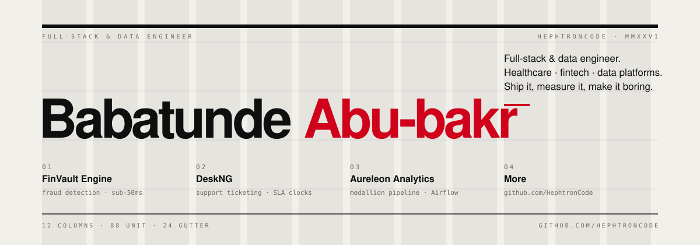

<!--
  HephtronCode — profile README
  One self-hosted header SVG (assets/swiss-grid.svg); everything else is
  plain Markdown. No scripts, no inline CSS.
  The "Recently forging" section below is rewritten by
  .github/workflows/forge-update.yml (scripts/forge-update.js).
-->

  

---

## 🕘 Recently forging

What I shipped last — rewritten automatically every few hours:

<!-- FORGE_START -->
- Committing: *"docs: dedicated SCREENSHOTS gallery; add customer/archived/mobile views"* to **DeskNG---CRM**
- Committing: *"docs: update README and setup guides to reflect Airflow orchestration"* to **aureleon-analytics**
- Committing: *"Add README screenshots"* to **sales-dashboard**
- Committing: *"Refactor documentation and update .gitignore"* to **crypto-pipeline**
- Committing: *"Initialize Dockerized multi-service stack with NGINX, Node.js API, and PostgreSQL"* to **Dockerized-Multi-Service-Stack**
<!-- FORGE_END -->

---

## 🏆 Flagship: FinVault Engine

Real-time fraud detection for financial transactions. Rule-based systems generate ~95% false positives, so FinVault replaces them with behavioral profiling, velocity checks, and graph-based entity resolution.

- **40% fewer** false-positive alerts
- **Sub-50 ms** inference latency at 10K TPS
- **$2.3M+** potential fraud prevented in pilot

**Stack:** TypeScript · Redis Streams · PostgreSQL · ML pipelines · Kubernetes

[Repository](https://github.com/HephtronCode/FinVault-Fraud-detection-engine) · [Architecture docs](https://github.com/HephtronCode/FinVault-Fraud-detection-engine#architecture)

---

## 📦 Selected work

| Project | What it does | Stack | Links |
| --- | --- | --- | --- |
| **DeskNG — Support Ticketing CRM** | Role-based ticketing with automated SLA clocks for Nigerian merchant operations — capstone built end-to-end | Express 5 · Mongoose 9 · Zod · React | [Repo](https://github.com/HephtronCode/DeskNG---CRM) |
| **Aureleon Analytics** | Medallion (bronze → silver → gold) transactional data pipeline with Airflow orchestration and data-quality gates | Python · PostgreSQL · Airflow | [Repo](https://github.com/HephtronCode/aureleon-analytics) |
| **Panacea EMR** | Hospital management focused on clinical compliance and HIPAA-ready architecture | React 19 · Node.js · MongoDB · Docker | [Repo](https://github.com/HephtronCode/panacea-emr-project) · [Demo](https://panacea-emr-demo.vercel.app) |
| **Vuzima Pharma Go** | Pharmaceutical operations platform with batch tracking and regulatory compliance | PostgreSQL · Redis · Docker · Node.js | [Repo](https://github.com/HephtronCode/vuzima-pharmapp) · [Demo](https://vuzima-demo.vercel.app) |
| **codeReviewAgent-007** | AI-assisted automated code review on PR workflows | TypeScript · LLM · GitHub Actions | [Repo](https://github.com/HephtronCode/codeReviewAgent-007) · [Demo](https://codereviewagent-demo.vercel.app) |

<b>More work</b> — dashboards, pipelines, and smaller MVPs

| Project | What it does | Links |
| --- | --- | --- |
| Sales Dashboard | Fintech merchant ops & reconciliation portal; custom design system, a11y-first | [Repo](https://github.com/HephtronCode/sales-dashboard) |
| Crypto Pipeline | CoinGecko ETL → MySQL warehouse → Streamlit dashboard, orchestrated with Airflow | [Repo](https://github.com/HephtronCode/crypto-pipeline) |
| Dockerized Multi-Service Stack | Multi-container stack demonstrating service orchestration | [Repo](https://github.com/HephtronCode/Dockerized-Multi-Service-Stack) |
| Tiny Tama | Spec-driven digital pet MVP with browser-native SQLite (Wasm) persistence | [Repo](https://github.com/HephtronCode/tiny-tama-mvp-final) · [Demo](https://tinytama-demo.vercel.app) |
| KendariKids | Child development tracking platform; milestone monitoring & learning pathways | [Repo](https://github.com/HephtronCode/kendariKids-MVP-Project) · [Demo](https://kendarikids-demo.vercel.app) |
| Hermes Task & Weather App | TypeScript productivity app (tasks + weather) | [Repo](https://github.com/HephtronCode/Hermes-task-and-weather-app) |
| API mini-projects | Task manager, student management, store inventory, product API backends | [task-manager](https://github.com/HephtronCode/task-manager) · [student-management](https://github.com/HephtronCode/student-management-API) · [store-inventory](https://github.com/HephtronCode/store_inventory-API) · [product-api](https://github.com/HephtronCode/Product-API-Backend) |
| Learning track | Data Engineering Zoomcamp, LLM Zoomcamp, AI-for-Beginners coursework — foundations kept sharp | [link](https://github.com/HephtronCode?tab=repositories) |

---

## 🧰 Stack

| Area | Tools |
| --- | --- |
| Frontend | React 19 · TypeScript · Vite · Tailwind v4 · Framer Motion |
| Backend | Node.js 22 · Express 5 · MongoDB · PostgreSQL · Redis · REST/GraphQL · Zod |
| Data | Python · Apache Spark · dbt · Airflow · Databricks · SQL · ETL/ELT |
| Cloud / DevOps | Docker · Kubernetes · GitHub Actions · AWS/GCP basics · CI/CD |

---

<b>Credentials · Writing · Connect</b>

### Credentials

| Credential | Issuer | Verification |
| --- | --- | --- |
| McKinsey Forward Program | McKinsey & Company | [Verify](https://www.mckinsey.com/careers/mckinsey-forward) |
| ALX Python / Full-stack | ALX Africa / Holberton School | [Verify](https://www.alxafrica.com/) |
| UN Peace Studies | United Nations | [Verify](https://peacekeeping.un.org/) |

### Writing

| Title | Platform | Year |
| --- | --- | --- |
| *Building Fraud Detection Systems That Don't Cry Wolf* | Dev.to | 2025 |
| *From Spec to Ship: SDD in Practice* | Hashnode | 2024 |
| *Healthcare Data Compliance: Beyond HIPAA Checkboxes* | Medium | 2024 |

### Elsewhere

[LinkedIn](https://www.linkedin.com/in/babatunde-yahaya/) · [X / Twitter](https://x.com/Great_Bakr) · [Blog](https://blog.hephtroncode.dev) · [Dev.to](https://dev.to/hephtroncode) · [Resume](https://hephtroncode.dev/resume.pdf) · [Email](mailto:tunde.bouba@gmail.com)

---

One self-hosted SVG, otherwise plain Markdown · no scripts — maintained with GitHub Actions.
